# VLAN Segmentation and Inter-VLAN Routing

A Cisco Packet Tracer networking lab demonstrating VLAN segmentation, router-on-a-stick inter-VLAN routing, extended access control lists (ACLs), and switch port security.

## Project Overview

This project simulates a small organization's network divided into three departmental VLANs: Human Resources (HR), Finance, and IT.

VLANs separate departmental broadcast domains, while router-on-a-stick enables communication between VLANs. An extended ACL enforces a directional traffic policy between HR and Finance, and switch port security restricts the number of secure MAC addresses permitted on a designated access port.

## Objectives

- Create and configure departmental VLANs.
- Configure access ports and 802.1Q trunk links.
- Implement router-on-a-stick inter-VLAN routing.
- Apply an extended ACL to restrict HR-initiated traffic to Finance.
- Configure sticky MAC address learning and switch port security.
- Verify routing, connectivity, and access-control behavior.

## Network Topology

### Devices

- 1 Cisco 2911 router (R1)
- 2 Cisco 2960 switches (SW1 and SW2)
- 4 end devices

### Connections

| Connection | Interface |
|---|---|
| R1 ↔ SW1 | R1 G0/0 ↔ SW1 G0/1 |
| SW1 ↔ SW2 | SW1 G0/2 ↔ SW2 G0/1 |
| SW1 ↔ PC-HR1 | SW1 Fa0/1 |
| SW1 ↔ PC-FIN1 | SW1 Fa0/2 |
| SW2 ↔ PC-IT1 | SW2 Fa0/1 |
| SW2 ↔ PC-HR2 | SW2 Fa0/2 |

### Topology Screenshot

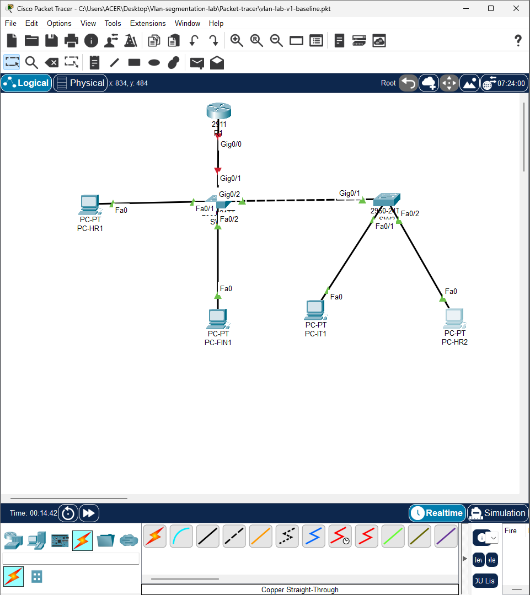

## VLAN and IP Addressing Plan

| VLAN | Name | Network | Default Gateway |
|---:|---|---|---|
| 10 | HR | 192.168.10.0/24 | 192.168.10.1 |
| 20 | FINANCE | 192.168.20.0/24 | 192.168.20.1 |
| 30 | IT | 192.168.30.0/24 | 192.168.30.1 |
| 99 | NATIVE | No end-host subnet assigned | Not applicable |

### End-Device Addressing

| Device | VLAN | IP Address | Default Gateway |
|---|---:|---|---|
| PC-HR1 | 10 | 192.168.10.11/24 | 192.168.10.1 |
| PC-HR2 | 10 | 192.168.10.12/24 | 192.168.10.1 |
| PC-FIN1 | 20 | 192.168.20.11/24 | 192.168.20.1 |
| PC-IT1 | 30 | 192.168.30.11/24 | 192.168.30.1 |

## Implementation

### 1. VLANs and Switching

The network uses four VLANs:

- **VLAN 10 — HR**
- **VLAN 20 — FINANCE**
- **VLAN 30 — IT**
- **VLAN 99 — NATIVE**

Access ports are assigned to the appropriate departmental VLAN. Trunk links carry VLANs 10, 20, 30, and 99, with VLAN 99 configured as the native VLAN.

### 2. Inter-VLAN Routing

Router-on-a-stick is implemented on R1 using 802.1Q subinterfaces on GigabitEthernet0/0.

| Subinterface | VLAN | IP Address |
|---|---:|---|
| G0/0.10 | 10 | 192.168.10.1/24 |
| G0/0.20 | 20 | 192.168.20.1/24 |
| G0/0.30 | 30 | 192.168.30.1/24 |

Each subinterface serves as the default gateway for its respective VLAN.

### 3. Extended Access Control List

The extended ACL `HR-TO-FINANCE` is applied inbound on R1's G0/0.10 subinterface.

The policy:

- Permits ICMP echo replies from HR to Finance to support the tested reverse-direction ping.
- Denies other IP traffic from HR to Finance.
- Permits traffic not matched by the preceding entries.

**Important limitation:** This ACL is stateless. The ICMP exception supports the tested ping behavior; it does not provide general stateful return-traffic handling for arbitrary TCP or UDP sessions.

### 4. Switch Port Security

Port security is configured on SW1 FastEthernet0/1, connected to PC-HR1.

| Setting | Configuration or Result |
|---|---|
| Maximum secure MAC addresses | 1 |
| MAC learning | Sticky |
| Violation mode | Shutdown |
| Port status | Secure-up |
| Security violation count | 0 |

The configuration was verified to show one sticky secure MAC address and zero recorded violations.

## Verification and Results

The following connectivity tests were performed in Cisco Packet Tracer.

| Source | Destination | Expected Result | Observed Result |
|---|---|---|---|
| PC-HR1 | HR gateway (192.168.10.1) | Allow | Successful |
| PC-HR1 | PC-FIN1 (192.168.20.11) | Block | Blocked |
| PC-FIN1 | PC-HR1 (192.168.10.11) | Allow | Successful |
| PC-IT1 | IT gateway (192.168.30.1) | Allow | Successful |
| PC-IT1 | PC-HR1 (192.168.10.11) | Allow | Successful |
| PC-IT1 | PC-FIN1 (192.168.20.11) | Allow | Successful |

The tests demonstrate the configured directional access policy between HR and Finance while confirming the tested connectivity for IT.

### Verification Screenshots

**Switch trunk configuration**

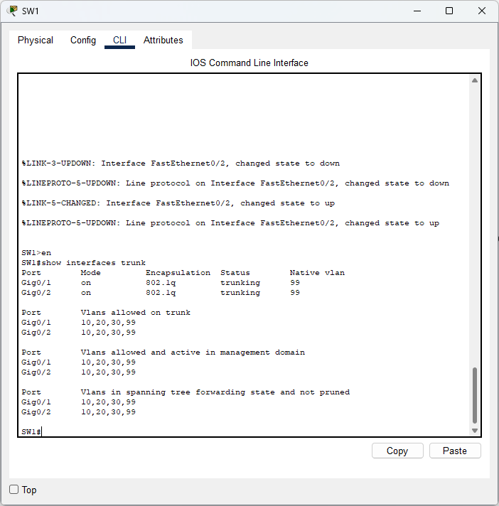

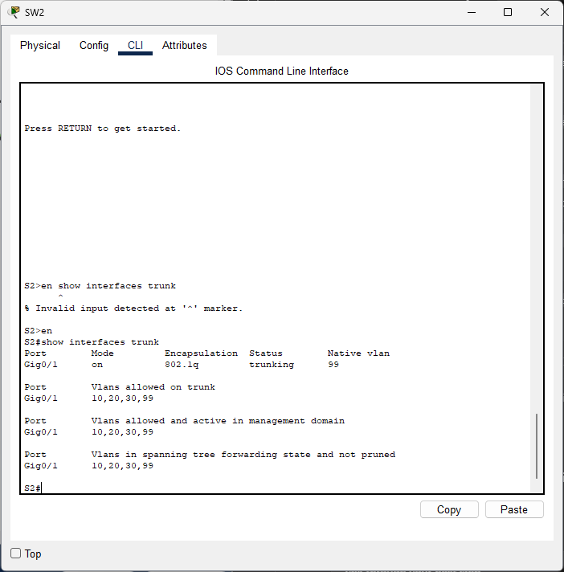

**Router interfaces and routing**

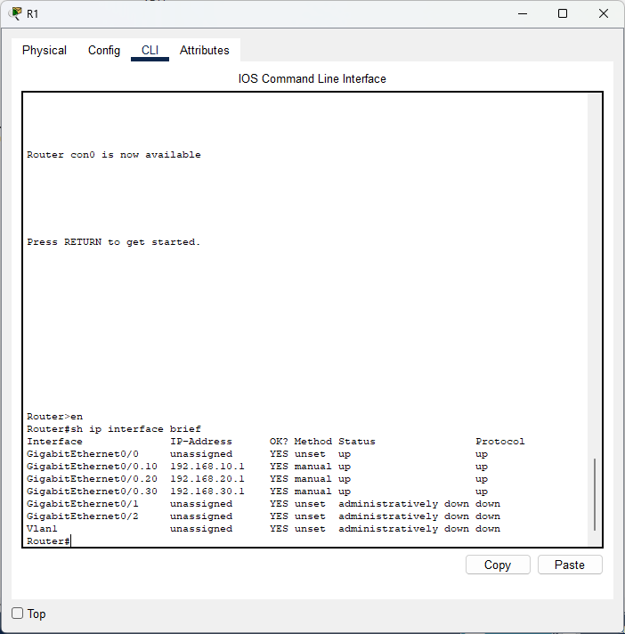

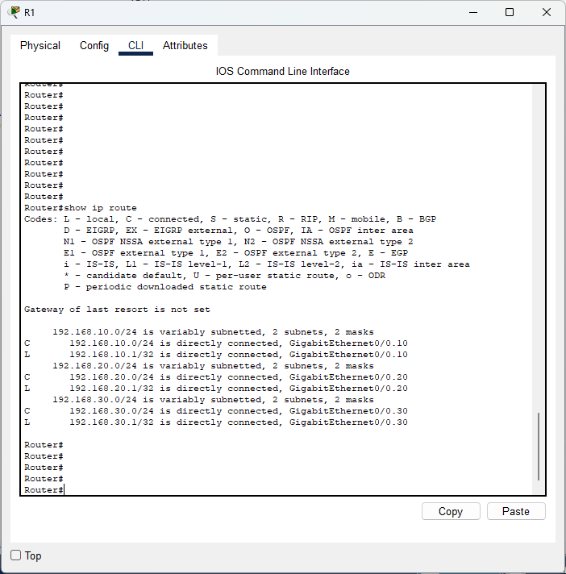

**ACL configuration and traffic behavior**

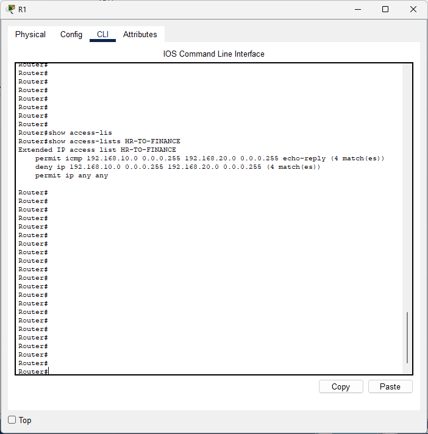

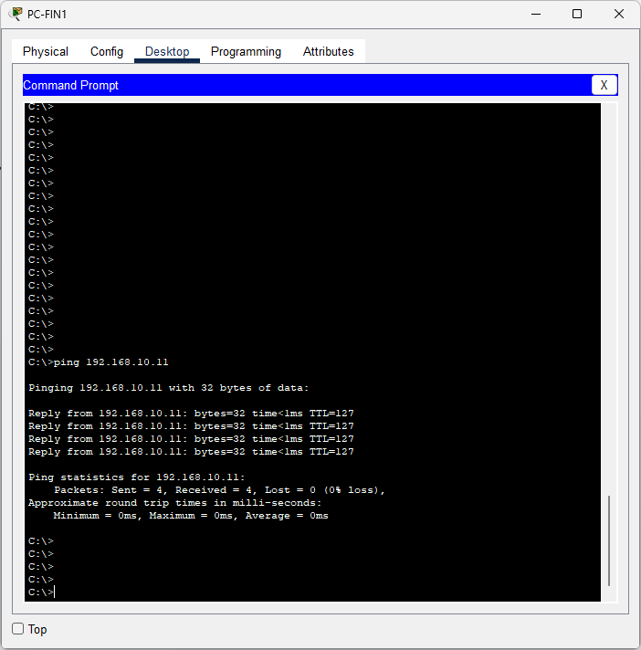

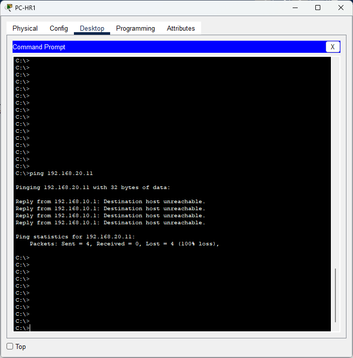

**Switch port security**

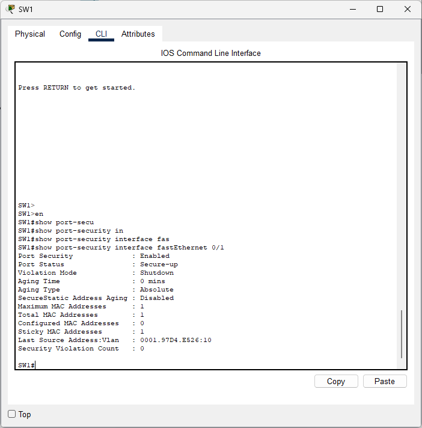

**Final connectivity tests**

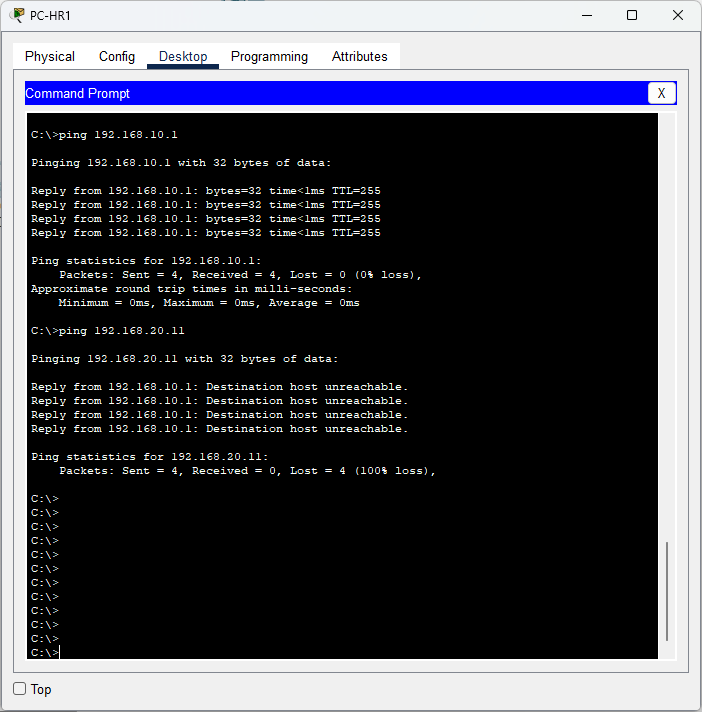


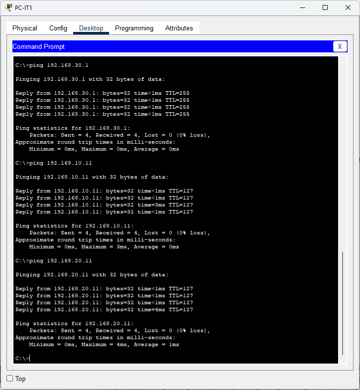

## Repository Structure

```text
vlan-segmentation-inter-vlan-routing/
├── README.md
├── Config/
│   ├── R1-running-config.txt
│   ├── SW1-running-config.txt
│   └── SW2-running-config.txt
├── Packet-tracer/
│   └── vlan-lab-v4-port-security.pkt
└── Screenshots/
    ├── 0.1-topology.png
    ├── 01-sw1-trunks.png
    ├── 02-sw2-trunks.png
    ├── 03-router-interfaces.png
    ├── 04-routing-table.png
    ├── 05-acl-rules.png
    ├── 06-finance-to-hr-allowed.png
    ├── 07-hr-to-finance-blocked.png
    ├── 08-sw1-port-security.png
    ├── 09-final-hr-connectivity-tests.png
    ├── 10-final-finance-to-hr-allowed.png
    └── 11-final-it-connectivity.png
```

## Tools and Technologies

- Cisco Packet Tracer
- Cisco IOS CLI
- VLANs and 802.1Q trunking
- Router-on-a-stick inter-VLAN routing
- IPv4 addressing and subnetting
- Extended ACLs
- Switch port security and sticky MAC learning
- ICMP connectivity testing

## How to Use

1. Open the `Packet-tracer/` folder.
2. Download `vlan-lab-v4-port-security.pkt`.
3. Open the file in Cisco Packet Tracer.
4. Inspect the topology, VLANs, trunk links, router subinterfaces, ACL, and port-security configuration.
5. Review the screenshots and configuration files to examine the implementation and verification results.

## Learning Outcomes

This project provided practical experience with VLAN segmentation, trunk configuration, inter-VLAN routing, ACL rule ordering and direction, switch port security, and systematic connectivity troubleshooting.
